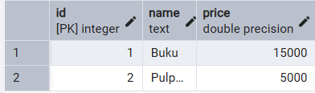
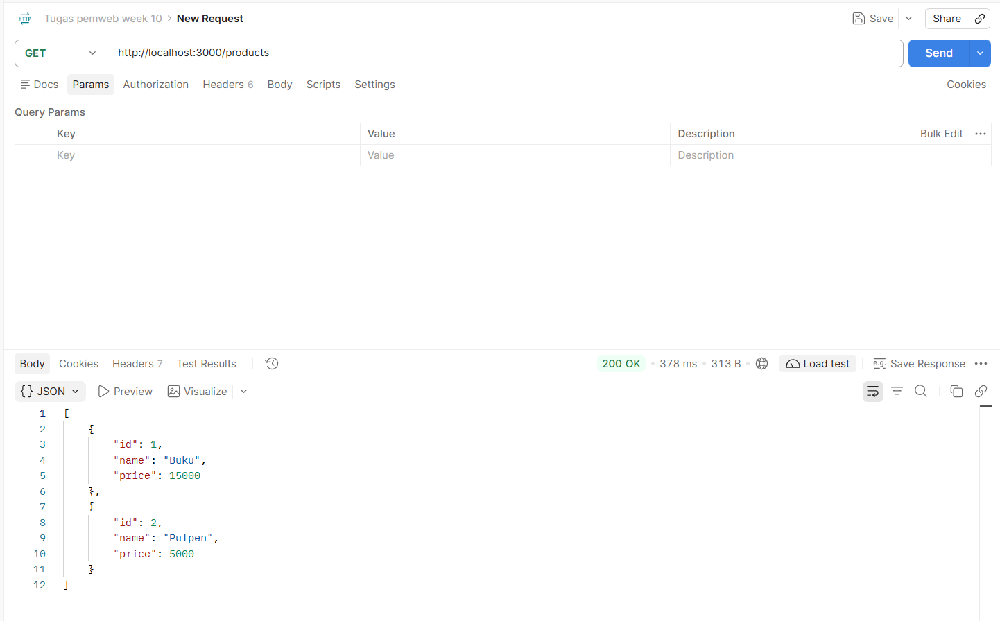
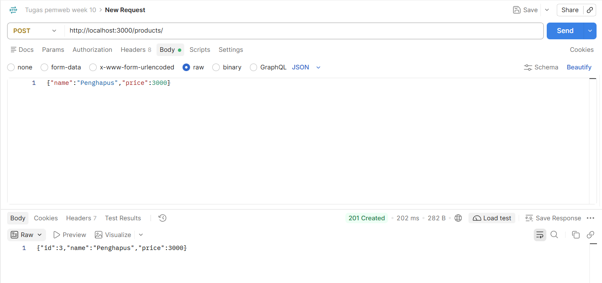
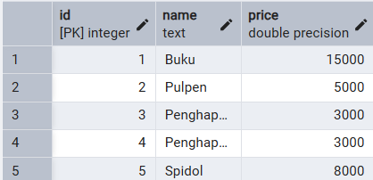
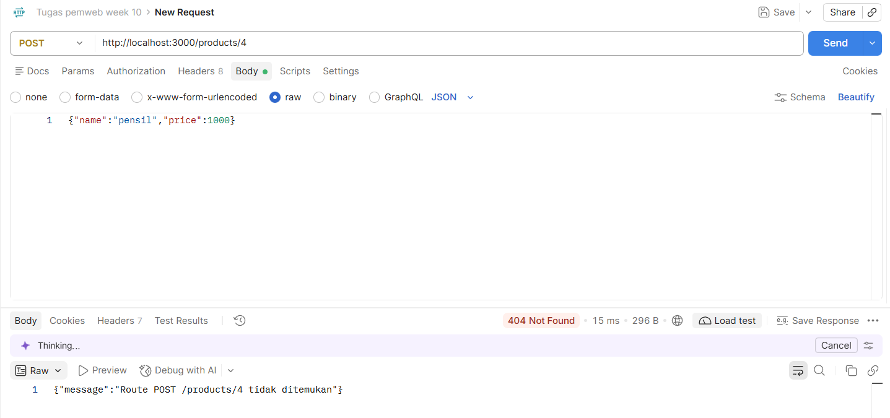
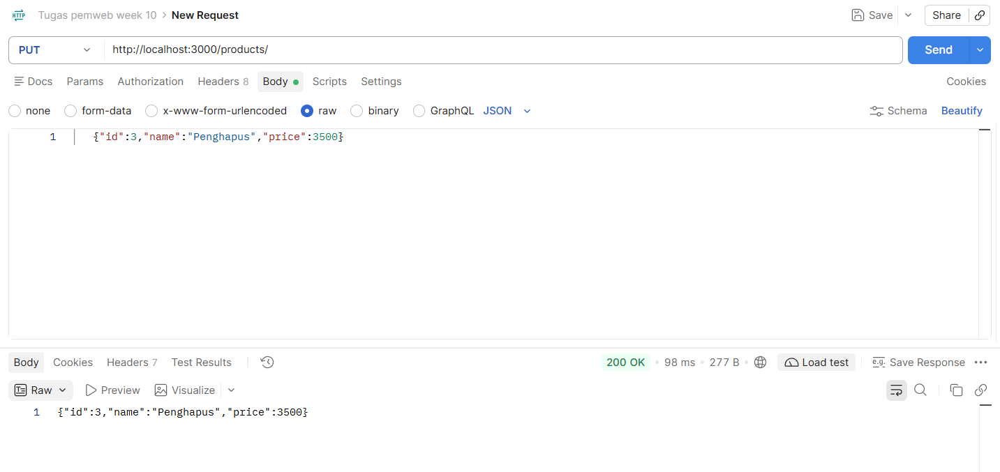
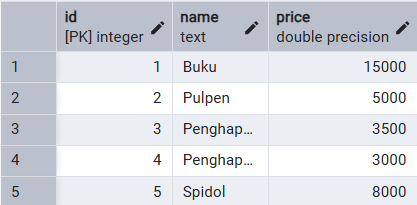
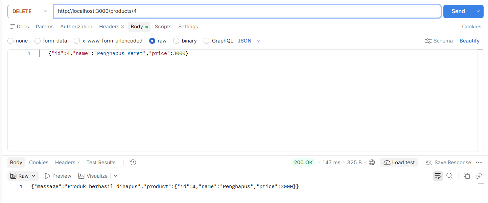
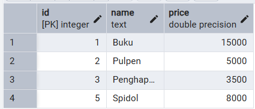
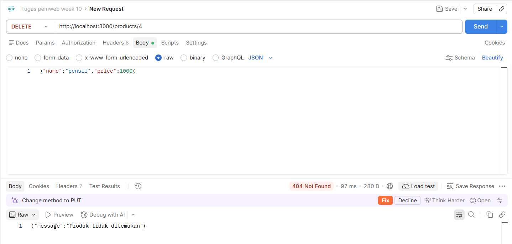

# Bukti Pengujian: API Daftar Produk (Week 10)
 
Pengujian dilakukan pada server lokal `http://localhost:3000` dengan **Postman**. Data produk disimpan di **PostgreSQL** dan diakses lewat **Prisma**. Isi tabel `Product` dilihat melalui pgAdmin.
 
## Kondisi awal database
 
Tabel `Product` berisi data awal dari seed sebelum pengujian dimulai.
 
| id | name | price |
| --- | --- | --- |
| 1 | Buku | 15000 |
| 2 | Pulpen | 5000 |
 

 
---
 
## Skenario 1: GET menampilkan seluruh data
 
**Tujuan:** memastikan API mengembalikan seluruh produk yang tersimpan di database.
 
**Request**
 
| Method | URL | Body |
| --- | --- | --- |
| GET | `http://localhost:3000/products` | - |
 
**Hasil yang diharapkan:** status `200 OK` dan array berisi seluruh produk.
 
```json
[
    {
        "id": 1,
        "name": "Buku",
        "price": 15000
    },
    {
        "id": 2,
        "name": "Pulpen",
        "price": 5000
    }
]
```
 
**Hasil pengujian (Postman)**
 

 
**Kesimpulan:** sesuai. Status `200 OK` dan respons memuat dua produk (Buku dan Pulpen) yang sama dengan isi tabel di database.
 
---
 
## Skenario 2: POST membuat data baru (berhasil)
 
**Tujuan:** memastikan data baru tersimpan ke database dan `id` dibuat otomatis oleh database.
 
**Request**
 
| Method | URL | Body (raw, JSON) |
| --- | --- | --- |
| POST | `http://localhost:3000/products/` | `{"name":"Penghapus","price":3000}` |
 
POST dikirim tiga kali dengan body `{"name":"Penghapus","price":3000}`, `{"name":"Penghapus","price":3000}`, dan `{"name":"Spidol","price":8000}`. Screenshot Postman hanya mendokumentasikan POST pertama (id 3). Hasil ketiganya terlihat pada tabel database di bawah.
 
**Hasil yang diharapkan:** status `201 Created` dan objek produk baru lengkap dengan `id`.
 
```json
{
    "id": 3,
    "name": "Penghapus",
    "price": 3000
}
```
 
**Hasil pengujian (Postman)**
 

 
**Perubahan database**
 
Sebelum POST (2 baris):
 

 
Sesudah tiga kali POST (3 baris baru, total 5 baris):


 
**Kesimpulan:** sesuai. Status `201 Created` dan produk baru mendapat `id` 3 dari database. Baris baru muncul di tabel `Product`.
 
---
 
## Skenario 3: POST ke endpoint yang tidak tersedia (gagal)
 
**Tujuan:** memastikan request ke route yang tidak terdaftar ditolak dan tidak mengubah database. API hanya menyediakan `POST /products`, tidak ada `POST /products/:id`.
 
**Request**
 
| Method | URL | Body (raw, JSON) |
| --- | --- | --- |
| POST | `http://localhost:3000/products/4` | `{"name":"pensil","price":1000}` |
 
**Hasil yang diharapkan:** status `404 Not Found` dengan pesan bahwa route tidak ditemukan. Tidak ada baris baru di tabel `Product`.
 
```json
{
    "message": "Route POST /products/4 tidak ditemukan"
}
```
 
**Hasil pengujian (Postman)**
 

 
**Kesimpulan:** sesuai. Server menolak request dengan `404 Not Found` karena tidak ada route `POST /products/4`, sehingga tidak ada data yang dimasukkan ke database.
 
---
 
## Skenario 4: PUT mengubah data yang sudah ada
 
**Tujuan:** memastikan data dengan `id` tertentu berubah di database. Body sama dengan POST, ditambah `id` produk yang diubah. Pada pengujian ini harga produk id 3 diubah dari 3000 menjadi 3500, sedangkan namanya tetap.
 
**Request**
 
| Method | URL | Body (raw, JSON) |
| --- | --- | --- |
| PUT | `http://localhost:3000/products/` | `{"id":3,"name":"Penghapus","price":3500}` |
 
**Hasil yang diharapkan:** status `200 OK` dan objek produk dengan data yang sudah diubah.
 
```json
{
    "id": 3,
    "name": "Penghapus",
    "price": 3500
}
```
 
**Hasil pengujian (Postman)**
 

 
**Perubahan database**
 
Sebelum PUT (produk id 3 masih berharga 3000):
 

 
Sesudah PUT (harga produk id 3 menjadi 3500, jumlah baris tetap 5):
 

 
**Kesimpulan:** sesuai. Status `200 OK` dan harga produk id 3 berubah menjadi 3500. Perubahan terlihat di tabel, sedangkan baris lain tidak berubah.
 
---
 
## Skenario 5: DELETE menghapus data (berhasil)
 
**Tujuan:** memastikan data dengan `id` tertentu terhapus dari database. Pada pengujian ini produk id 4 (duplikat Penghapus) dihapus.
 
**Request**
 
| Method | URL | Body |
| --- | --- | --- |
| DELETE | `http://localhost:3000/products/4` | - |
 
DELETE tidak memakai body. Isi tab Body pada screenshot adalah sisa dari request sebelumnya dan diabaikan oleh server, karena produk yang dihapus hanya ditentukan oleh id di URL.
 
**Hasil yang diharapkan:** status `200 OK` dan data produk yang dihapus.
 
```json
{
    "message": "Produk berhasil dihapus",
    "product": {
        "id": 4,
        "name": "Penghapus",
        "price": 3000
    }
}
```
 
**Hasil pengujian (Postman)**
 

 
**Perubahan database**
 
Sebelum DELETE (5 baris):
 

 
Sesudah DELETE (baris id 4 hilang, tersisa 4 baris):
 

 
**Kesimpulan:** sesuai. Status `200 OK` dan data produk id 4 dikembalikan. Baris id 4 hilang dari tabel, sedangkan baris lain tidak berubah.
 
---
 
## Skenario 6: DELETE data yang sudah tidak ada (gagal)
 
**Tujuan:** memastikan API menolak penghapusan data yang tidak ditemukan, tanpa mengubah database.
 
**Request**
 
| Method | URL | Body |
| --- | --- | --- |
| DELETE | `http://localhost:3000/products/4` | - |
 
Request ini sama dengan skenario 5 dan dikirim sekali lagi, sehingga produk id 4 sudah tidak ada. Isi tab Body pada screenshot kembali sisa dari request sebelumnya dan diabaikan oleh server.
 
**Hasil yang diharapkan:** status `404 Not Found`. Isi tabel `Product` tidak berubah (tetap 4 baris seperti setelah skenario 5).
 
```json
{
    "message": "Produk tidak ditemukan"
}
```
 
**Hasil pengujian (Postman)**
 

