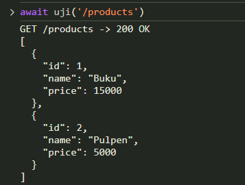
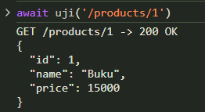
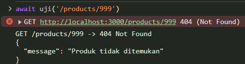
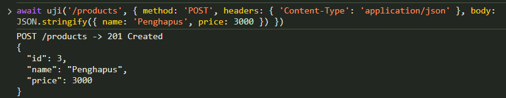
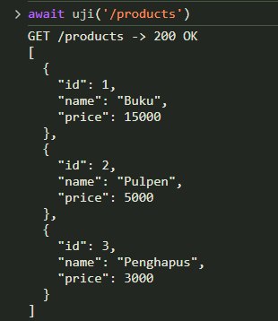
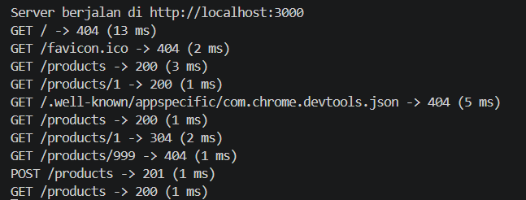

# Bukti Pengujian: API Daftar Produk

Pengujian dilakukan pada server lokal `http://localhost:3000` melalui browser, memakai perintah `fetch` di DevTools Console (F12). Data produk disimpan di array (tanpa database).

## Persiapan

1. Jalankan server di terminal dengan `npm start`.
2. Buka `http://localhost:3000/products` di browser, lalu tekan F12 dan pilih tab Console.
3. Tempel fungsi bantu berikut, lalu tekan Enter. Fungsi ini mengirim request dan mencetak status beserta body respons.

```js
async function uji(url, opsi) {
  const r = await fetch(url, opsi);
  const data = await r.json();
  console.log(`${opsi?.method ?? 'GET'} ${url} -> ${r.status} ${r.statusText}\n${JSON.stringify(data, null, 2)}`);
}
```

### 1. GET /products

Perintah:

```js
await uji('/products')
```

Hasil yang diharapkan: status `200 OK` dan array seluruh produk.

```
GET /products -> 200 OK
[
  { "id": 1, "name": "Buku", "price": 15000 },
  { "id": 2, "name": "Pulpen", "price": 5000 }
]
```



### 2. GET /products/1

Perintah:

```js
await uji('/products/1')
```

Hasil yang diharapkan: status `200 OK` dan objek produk Buku.

```
GET /products/1 -> 200 OK
{ "id": 1, "name": "Buku", "price": 15000 }
```



### 3. GET /products/999

Perintah:

```js
await uji('/products/999')
```

Hasil yang diharapkan: status `404 Not Found` dan pesan JSON bahwa produk tidak ditemukan.

```
GET /products/999 -> 404 Not Found
{ "message": "Produk tidak ditemukan" }
```



## B. Lanjutan di rumah: POST /products

### 4. POST /products

Perintah:

```js
await uji('/products', {
  method: 'POST',
  headers: { 'Content-Type': 'application/json' },
  body: JSON.stringify({ name: 'Penghapus', price: 3000 })
})
```

Hasil yang diharapkan: status `201 Created` dan objek produk baru dengan ID baru.

```
POST /products -> 201 Created
{ "id": 3, "name": "Penghapus", "price": 3000 }
```



### 5. GET /products setelah POST

Perintah:

```js
await uji('/products')
```

Hasil yang diharapkan: status `200 OK` dan produk baru ikut muncul di daftar.

```
GET /products -> 200 OK
[
  { "id": 1, "name": "Buku", "price": 15000 },
  { "id": 2, "name": "Pulpen", "price": 5000 },
  { "id": 3, "name": "Penghapus", "price": 3000 }
]
```



## C. Log server

Terminal tempat server berjalan mencatat setiap request beserta status akhirnya. Log yang diharapkan:

- `GET /products` dengan status `200`
- `GET /products/1` dengan status `200`
- `GET /products/999` dengan status `404`
- `POST /products` dengan status `201`
- `GET /products` dengan status `200`



**Catatan:** terdapat beberapa interaksi pada saat pengujian sehingga terdapat beberapa log lain yang muncul secara tidak sengaja.